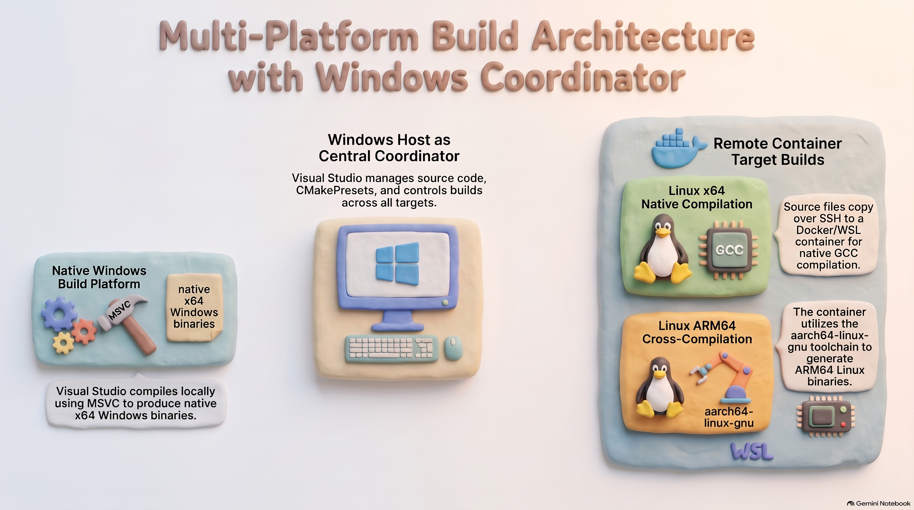

### **Multi-Platform Cross-Compilation Setup Guide**



This guide outlines the workflow for setting up a unified cross-compilation environment in Visual Studio on Windows to target **Windows (MSVC)**, **Linux x64**, and **Linux Arm64 (aarch64)** using a remote Docker build container.

---

## Prerequisites

- **Visual Studio:** Install a release that supports CMake Presets and remote Linux CMake projects, with the **Linux and embedded development with C++** workload. The exact tested Visual Studio release is not recorded in this repository.
- **CMake:** CMake 3.21 or newer is required to read the version 3 presets in [CMakePresets.json](project/CMakePresets.json).
- **Docker:** Docker Desktop or Docker Engine, with the daemon running.
- **RTI Connext DDS:** Obtain the 7.3.0 host installer and both target packages below. Place all three files in the repository root; the Docker build context is the repository root, and the Dockerfile copies these filenames from that context.
- **RTI license:** Set `RTI_LICENSE_FILE` on the host to the path of a valid license file before starting the container.

```text
rti_connext_dds-7.3.0-pro-host-x64Linux.run
rti_connext_dds-7.3.0-pro-target-x64Linux4gcc7.3.0.rtipkg
rti_connext_dds-7.3.0-pro-target-armv8Linux4gcc7.3.0.rtipkg
```

## Windows and Visual Studio workflow

### 1. Visual Studio workload setup

1. Install a supported Visual Studio release on your Windows development machine.
2. Add the **Linux and embedded development with C++** workload via the Visual Studio Installer.  
3. For detailed installation steps and dependency requirements, refer to the [Install the C++ Linux Workload in Visual Studio](https://learn.microsoft.com/en-us/cpp/linux/download-install-and-setup-the-linux-development-workload?view=msvc-180) documentation.

### 2. Build and start the Docker host

From the repository root, build a local development image and provide a unique SSH password when prompted:

```bash
printf 'Enter a unique SSH password: '
read -s SSHPASSWORD
printf '\n'
docker build -f artefacts/Dockerfile -t connext:buildhost \
   --build-arg RTI_LICENSE_AGREEMENT_ACCEPTED=accepted \
   --build-arg CONNEXT_VERSION=7.3.0 \
   --build-arg "SSHPASSWORD=$SSHPASSWORD" .
unset SSHPASSWORD
```

The final `.` is the build context: the three RTI packages must be in the repository root, even though the Dockerfile is under `artefacts/`. The command supplies the license-agreement acceptance, Connext version, and required SSH password build arguments. The Dockerfile has no default password. Build arguments may be retained in image metadata or build cache, so use this only for a local development image and do not distribute it. For shared environments, prefer SSH keys or a runtime-managed secret instead.

Start the container with SSH published only on the Docker host's loopback interface:

```bash
docker run -it --rm -p 127.0.0.1:23:23 \
   -v "$RTI_LICENSE_FILE:/root/rti_license.dat" connext:buildhost
```

This makes SSH available at `localhost:23` on that host without publishing it on other host interfaces. Do not remove the `127.0.0.1` binding unless access from another machine is specifically required and protected by network controls.
The image installs the Connext host and target packages, build tools, and the Arm64 cross-compiler (`gcc-aarch64-linux-gnu` / `g++-aarch64-linux-gnu`). SSH listens on port 23; connect as `developer` with the password supplied at build time.

### 3. Connect Visual Studio over SSH

1. Open Visual Studio and navigate to **Tools \> Options \> Cross Platform \> Connection Manager**.  
2. Add a new SSH connection pointing to your running Docker container or WSL instance using the configured port and credentials.  
3. Step-by-step connection manager instructions and troubleshooting are detailed in [Connect to a Target Linux System by Using Visual Studio](https://learn.microsoft.com/en-us/cpp/linux/connect-to-your-remote-linux-computer?view=msvc-180).

### 4. Configure CMake presets

1. Structure your project around a central [CMakeLists.txt](project/CMakeLists.txt) that defines your executable targets, IDL code generation, and package dependencies.  
2. Configure build presets for all three target platforms within [CMakePresets.json](project/CMakePresets.json):  
   * **Windows Target**: Local MSVC compiler.  
   * **Linux x64 Target**: Remote compilation over SSH inside the container.  
   * **Linux Arm64 Target**: Remote cross-compilation inside the container utilizing [aarch64-toolchain.cmake](project/aarch64-toolchain.cmake).  
3. In Visual Studio, select the target system (local Windows or remote Linux) and desired preset from the configuration dropdown to trigger CMake generation and builds across any of the three platforms.  
4. For further details on CMake cache generation and remote source synchronization, see [Configure a Linux CMake Project in Visual Studio](https://learn.microsoft.com/en-us/cpp/linux/cmake-linux-configure?view=msvc-180).

---

## WSL alternative

The Dockerfile is based on Ubuntu 22.04 (Jammy). To use WSL instead, install an Ubuntu 22.04 WSL distribution and perform the equivalent setup inside it:

1. Install the build dependencies and cross-compiler:

```bash
sudo apt update
sudo apt install -y ca-certificates git build-essential cmake curl libcurlpp-dev \
   zlib1g-dev nano tmux rsync zip ninja-build openssh-server iproute2 file \
   gcc-aarch64-linux-gnu g++-aarch64-linux-gnu
```

2. Copy the three RTI packages listed in the prerequisites into a directory in WSL. From that directory, install the host tools and both target packages:

```bash
chmod +x rti_connext_dds-7.3.0-pro-host-x64Linux.run
sudo ./rti_connext_dds-7.3.0-pro-host-x64Linux.run --disable_copy_examples true --mode unattended
sudo /opt/rti_connext_dds-7.3.0/bin/rtipkginstall -u rti_connext_dds-7.3.0-pro-target-x64Linux4gcc7.3.0.rtipkg
sudo /opt/rti_connext_dds-7.3.0/bin/rtipkginstall -u rti_connext_dds-7.3.0-pro-target-armv8Linux4gcc7.3.0.rtipkg
```

3. Make a valid RTI license available inside WSL, for example at `$HOME/rti_license.dat`, and add the Connext environment to your shell startup file (`~/.bashrc`):

```bash
export NDDSHOME=/opt/rti_connext_dds-7.3.0
export RTI_LICENSE_FILE="$HOME/rti_license.dat"
source "$NDDSHOME"/resource/scripts/rtisetenv_x64Linux*.bash
```

4. Configure SSH for Visual Studio: set `Port 23` and `PasswordAuthentication yes` in `/etc/ssh/sshd_config`, set a password for your WSL user with `passwd`, then start the server with `sudo service ssh start`. Connect Visual Studio to `localhost` on port `23` using that WSL username and password. If port 23 is already in use, choose another SSH port and use it in Visual Studio's connection settings.

The AArch64 preset and [toolchain file](project/aarch64-toolchain.cmake) expect the compiler paths and Connext architecture installed above. Start `sshd` again after restarting WSL unless SSH is configured to start automatically.

---

## Manual Docker workflow: aarch64 example

Use this path when building manually rather than through Visual Studio. Build the image using the command in the Windows/Visual Studio workflow above, then start the container:

For non-MSVC builds, here's how to build a project manually:

1. Start the docker container with a parameter to forward local port 23 to 23

```bash
$ docker run -it --rm -p 127.0.0.1:23:23 -v "$RTI_LICENSE_FILE:/root/rti_license.dat" connext:buildhost
```

2. Connect to the host from a separate terminal:
```bash
$ ssh developer@localhost -p 23
```

3. Copy the project folder to the Docker container from another terminal
```bash
$ rsync -avz -e 'ssh -p 23' ./project developer@localhost:~/
```

4. Switch back to the terminal running ssh and configure the build

```bash
$ cd project

$ cmake -S . -B build-aarch64 \
> -DCMAKE_TOOLCHAIN_FILE=./aarch64-toolchain.cmake \
> -DCONNEXTDDS_ARCH=armv8Linux4gcc7.3.0 \
> -DCMAKE_BUILD_TYPE=Release
```

5. Go to the newly created build-aarch64 folder and run the build
```bash
$ cd build-aarch64
$ cmake --build .
```